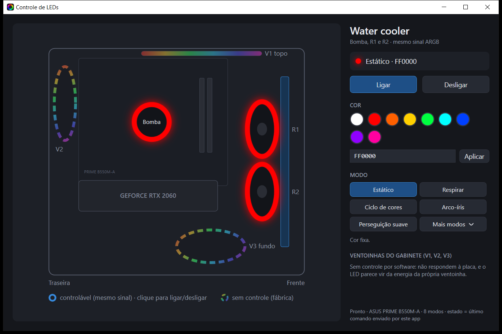

# Controle de LEDs

App de Windows para ligar, desligar e trocar a cor e o efeito dos LEDs do water cooler do meu PC. Mostra o gabinete desenhado com cada LED no lugar.



- **O que controla:** a bomba e as 2 ventoinhas do radiador do water cooler Rise Mode. As 3 recebem o mesmo sinal, então acendem sempre iguais.
- **O que não controla:** as 3 ventoinhas do gabinete (V1, V2 e V3). Elas não passam pela placa-mãe e mostram um arco-íris de fábrica.
- **Como funciona:** o app chama a linha de comando do [OpenRGB](https://openrgb.org), que fala com o controlador de LED da placa-mãe por USB. Não instala driver de kernel nem precisa de administrador.

---

## Reinstalar depois de formatar

Siga na ordem. Leva uns 10 minutos.

### 1. Antes de instalar o Windows (BIOS)

Placas ASUS oferecem instalar o **Armoury Crate** sozinho no primeiro boot do Windows. Ele é pesado e briga com o OpenRGB pelo controle dos LEDs.

- Entre no BIOS (tecla **Del** ao ligar) → **Advanced Mode (F7)** → **Tool** → **ASUS Armoury Crate**.
- Deixe **Download & Install ARMOURY CRATE app** em **Disabled**.
- Se o Windows perguntar se quer instalar o Armoury Crate, recuse.

### 2. Instalar o OpenRGB

1. Baixe o **OpenRGB 1.0** para Windows (instalador `.msi` ou zip) em <https://openrgb.org/releases.html>.
2. Instale em **`D:\Programas\OpenRGB\`**, que é o caminho que o app procura.
   - Se o disco D: não foi formatado, confira se `D:\Programas\OpenRGB\OpenRGB.exe` ainda existe. Nesse caso, pule a instalação.
   - Para instalar em outro lugar, veja [Configuração](#configuração).
3. Abra o OpenRGB **uma vez** e espere ele detectar os dispositivos. Precisa aparecer **ASUS PRIME B550M-A**.
   - Um aviso sobre **PawnIO / I2C / SMBus** é esperado e pode ser ignorado. Esse driver só serve para memória RAM e placa de vídeo, que não usamos. **Não instale o PawnIO.**

### 3. Ajustar o tamanho da zona ARGB (uma vez só)

Por padrão, o OpenRGB acha que o conector ARGB tem 6 LEDs, mas cada ventoinha do radiador tem até 20. Sem esse ajuste, o modo **Direto** acende só parte das ventoinhas. Os outros modos funcionam mesmo sem o ajuste.

1. No OpenRGB, selecione **ASUS PRIME B550M-A**.
2. Em **Zone**, escolha **Addressable RGB Header 1** e clique em **Resize Zone**.
3. Coloque **20** e confirme.

> O ajuste fica salvo em `%APPDATA%\OpenRGB\Configuration.json`. Quem preferir pode editar o arquivo direto: no dispositivo `ASUS PRIME B550M-A`, na zona `Addressable RGB Header 1`, troque `leds_count` para `20`.

### 4. Fechar o OpenRGB

**Importante:** feche a janela do OpenRGB, conferindo também a área de notificação perto do relógio. Com a interface aberta ela segura o USB, e o app avisa e não manda nada.

### 5. Baixar o app

Na página do repositório no GitHub, abra **Releases** e baixe o **`ControleLeds.exe`** da versão mais nova.

- É um arquivo único, de ~62 MB, e já traz o .NET dentro. Não precisa instalar mais nada.
- Coloque onde quiser (ex.: `D:\Programas\ControleLeds\`) e crie um atalho na área de trabalho ou no Iniciar.
- O Windows SmartScreen pode avisar que o app não é reconhecido, porque ele não é assinado. Clique em **Mais informações → Executar assim mesmo**.

Prefere compilar a partir do código? Veja [Compilar](#compilar).

### 6. Testar

Abra o app e clique em **Ligar**, depois **Desligar**. A bomba e as ventoinhas do radiador devem obedecer em cerca de 1 segundo.

### Windows 11: Iluminação dinâmica

O Windows 11 tem a função **Iluminação dinâmica**, que pode tentar controlar os LEDs de alguns dispositivos. Se os LEDs ficarem trocando sozinhos ou ignorarem o app:

- Abra **Configurações → Personalização → Iluminação dinâmica**.
- Desligue **Usar a Iluminação dinâmica em meus dispositivos**, ou só o dispositivo da placa, se ele aparecer na lista.

---

## Usando o app

| Controle | O que faz |
|---|---|
| **Ligar** | Volta ao último modo e à última cor usados |
| **Desligar** | Apaga a bomba e as ventoinhas do radiador |
| Clique na **bomba**, **R1** ou **R2** no desenho | Liga ou desliga |
| **Cor** (paleta ou campo `RRGGBB`) | Aplica a cor no modo atual. Se o modo não usa cor (Arco-íris, Ciclo de cores), troca para Estático |
| **Modo** | Estático, Respirar, Ciclo de cores, Arco-íris, Perseguição suave |
| **Mais modos** | Direto, Piscar, Perseguição |

A placa não aceita velocidade nem brilho em nenhum modo, por isso o app não tem esses controles.

**Limitações conhecidas:**
- **Direto** fica igual ao Estático, porque usa uma cor só para todos os LEDs.
- **Perseguição** e **Perseguição suave** têm uma pausa longa entre as passadas. O efeito roda no firmware da placa, que percorre o comprimento máximo do conector ARGB e não só os 20 LEDs reais. O ajuste de tamanho da zona (passo 3) fica só dentro do OpenRGB e não chega ao hardware, então não há como corrigir isso pelo OpenRGB. A saída seria o próprio app animar o efeito pelo modo Direto, o que fica para uma versão futura.
- O app mostra o **último comando que ele mesmo enviou**, guardado em `%LOCALAPPDATA%\ControleLeds\estado.json`. Ele não lê o estado real dos LEDs, porque a linha de comando do OpenRGB não devolve nada. Depois de formatar, o app começa como "Estado desconhecido" até o primeiro clique.

## Script de linha de comando

O `leds.sh` faz o básico pelo Git Bash, sem abrir o app:

```bash
./leds.sh ligar FF0000   # cor fixa (padrão FFFFFF)
./leds.sh desligar
./leds.sh arco-iris
```

---

## Configuração

Para mudar o caminho do OpenRGB ou quais modos ficam no menu, crie um **`ControleLeds.json` ao lado do `.exe`**. O arquivo [`ControleLeds.exemplo.json`](ControleLeds.exemplo.json) traz os valores padrão:

```json
{
  "CaminhoOpenRgb": "D:\\Programas\\OpenRGB\\OpenRGB.exe",
  "Dispositivo": "ASUS PRIME B550M-A",
  "ModosNoMenu": [ "Direct", "Flashing", "Chase" ]
}
```

- `Dispositivo` é o nome exato que o OpenRGB mostra para a placa.
- `ModosNoMenu` usa os nomes em inglês do OpenRGB: `Direct`, `Static`, `Breathing`, `Flashing`, `Spectrum Cycle`, `Rainbow`, `Chase Fade`, `Chase`.

## Compilar

1. Instale o **.NET 9 SDK**: `winget install Microsoft.DotNet.SDK.9`.
2. Na raiz do repositório:

   ```powershell
   dotnet publish src/ControleLeds -c Release -o publicado
   ```

3. O executável fica em `publicado\ControleLeds.exe`. É autocontido: copie só esse arquivo.

O ícone (`src/ControleLeds/icone.ico`) é gerado por `tools/GerarIcone`:

```powershell
dotnet run --project tools/GerarIcone -- src/ControleLeds/icone.ico
```

### Estrutura

```
src/ControleLeds/
  Hardware/ControladorWaterCooler.cs  chama a CLI do OpenRGB e guarda o estado
  Hardware/ModoLuz.cs                 lista de modos, lida do Configuration.json do OpenRGB
  MainWindow.xaml(.cs)                desenho do gabinete e painel de controles
  Configuracao.cs                     leitura do ControleLeds.json
leds.sh                               script bash equivalente
tools/GerarIcone/                     gerador do ícone
```

---

## Hardware deste PC

| Item | Detalhe |
|---|---|
| Placa-mãe | ASUS PRIME B550M-A, com controlador de LED **ASUS Aura USB** (`0B05:1939`) |
| Conector **ARGB 5 V (3 pinos)** | Bomba + 2 ventoinhas do radiador, **em paralelo**, no mesmo sinal |
| Conectores **RGB 12 V (4 pinos)** | Nada ligado |
| Ventoinhas do gabinete (V1 topo, V2 traseira, V3 fundo) | Cabo empilhável de 3/4 pinos, provavelmente só energia. Efeito de fábrica, sem controle por software |

Mapa medido no OpenRGB, no dispositivo `ASUS PRIME B550M-A`:
- **Zona 0, `Aura Mainboard`:** conector RGB 12 V, nada ligado.
- **Zona 1, `Addressable RGB Header 1`:** water cooler. A bomba tem até 10 LEDs e cada ventoinha do radiador tem de 11 a 20.

### Por que a linha de comando e não o servidor SDK do OpenRGB

O pacote [OpenRGB.NET](https://www.nuget.org/packages/OpenRGB.NET) 3.1.1 fala o protocolo 4. Com o OpenRGB 1.0, o servidor **ignora a troca de modo**, sem registrar erro, e o modo Direct apaga sozinho no hardware. A linha de comando funciona em todos os modos. O custo é cerca de 1 segundo por comando, porque o OpenRGB detecta os dispositivos a cada chamada.

### Ideia futura: controle separado por peça

A placa tem um único conector ARGB, então tudo recebe o mesmo sinal. Para controlar cada peça separadamente, o plano é:

- **Controladora:** uma **Nollie 8** (8 canais ARGB, USB 2.0 interno e alimentação SATA), suportada pelo OpenRGB.
- **Ventoinhas:** 3 Rise Mode com **PWM de 4 pinos + ARGB de 3 pinos**, como a Aura Pro ou a Hex Turbine PWM, uma por canal.
- **Water cooler:** continua no conector da placa.

Isso exigiria uma v2 do app, com um controle por canal.

## Solução de problemas

| Sintoma | Causa provável |
|---|---|
| "A interface do OpenRGB está aberta…" | Feche o OpenRGB, conferindo também a área de notificação |
| "OpenRGB não encontrado em …" | Instale o OpenRGB em `D:\Programas\OpenRGB\` ou ajuste o `ControleLeds.json` |
| Clique aceito, mas nada muda | Veja o log mais recente em `%APPDATA%\OpenRGB\logs` e confirme que a placa aparece no OpenRGB. No Windows 11, desligue a Iluminação dinâmica |
| Só parte das ventoinhas acende no Direto | Zona ARGB com 6 LEDs: refaça o [passo 3](#3-ajustar-o-tamanho-da-zona-argb-uma-vez-só) |
| A linha de comando do OpenRGB não mostra nada no terminal | Normal no Windows. A saída vai só para o log |
